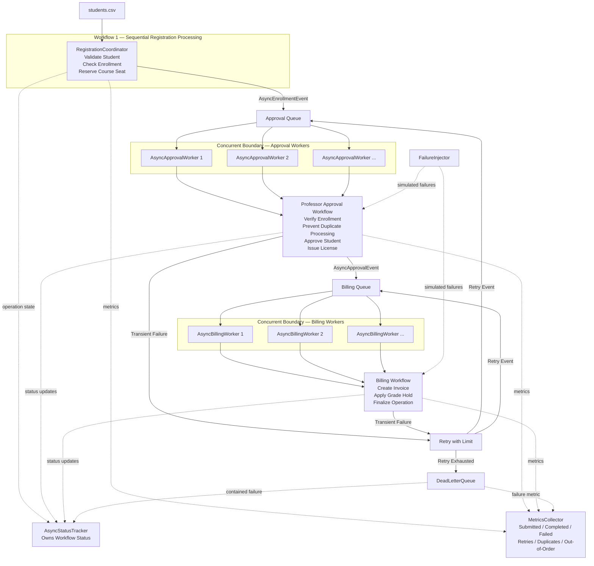

# Student Registration System
## Final Capstone Documentation
### Assignment 4 – Capstone System Under Stress

Michael Jan  
**Course:** CS 5254 – Concurrent Object-Oriented Programming 

---

# Table of Contents

1. Overview
2. System Evolution (A1 → A4)
3. Final System Architecture
    - 3.1 Design Goals
    - 3.2 Overall Architecture
    - 3.3 Major Components
    - 3.4 Object Responsibilities
    - 3.5 Concurrency and Asynchronous Boundaries
    - 3.6 State Ownership
4. System Invariants
5. Assignment 4 Enhancements
    - 5.1 Validation Framework
    - 5.2 Failure Injection
    - 5.3 Retry and Recovery
    - 5.4 Dead Letter Queue
    - 5.5 Metrics Collection
    - 5.6 Stress Testing
6. Validation Methodology
7. Experimental Evaluation and Results
    - 7.1 Test Strategy
    - 7.2 Experimental Scenarios
    - 7.3 Stress Testing
    - 7.4 Validation Results
    - 7.5 Java vs. Python Results
    - 7.6 Engineering Decisions
8. Design Reflection
9. Lessons Learned
10. Future Improvements
11. Requirement Traceability Matrix
12. AI Usage
13. Running the Project
14. Repository Structure
15. Conclusion

# Submission Artifacts

In addition to the Java and Python implementations, the following supporting artifacts are included with the Assignment 4 submission:

| Artifact | Location | Purpose |
|---|---|---|
| **Individual Integrity Packet** | `integrity-packet/individual-integrity-packet.md` | Summarizes the final design recommendation, assumptions, validation evidence, ownership, system limitations, escalation process, and reflection. |
| **AI Usage Log** | `shared/ai-usage-log.md` | Documents AI-assisted development, review, and independent verification performed throughout the project. |
| **System Defense Presentation** | `shared/A4-System-Defense.pptx` | Presents the final architecture, design decisions, failure handling, validation evidence, Java/Python comparison, AI review, and future improvements. |

The remainder of this README provides the complete technical documentation, architecture, validation methodology, experimental results, and instructions for running both implementations.


---

# 1.  Overview

This project represents the final version of the Student Registration System developed throughout the semester. From the first assignment to the final assignment, the project demonstrates the evolution of the system. Assignment 1 established the object-oriented foundation, Assignment 2 introduced coordinated workflows, Assignment 3 transitioned the design to an asynchronous event-driven architecture, and Assignment 4 focuses on demonstrating that the architecture continues to operate correctly under stress, concurrent execution, and partial failures.

The project continuously evolves the existing architecture while preserving the original domain model and business logic. As new requirements were introduced, the system was extended with additional capabilities such as asynchronous workers, configurable failure injection, retry mechanisms, dead-letter queue processing, metrics collection, and a comprehensive validation framework. This allowed the architecture to grow naturally while keeping each component focused on a specific responsibility.

One of the primary design goals was to separate business logic from concurrency management. The domain services continue to enforce the registration rules, while events, queues, and worker threads handle asynchronous execution. This separation makes it easier to reason about correctness, add new functionality, and validate the behavior of the system under a variety of operating conditions.

The final project is implemented in both Java and Python using the same overall architecture and workflow. Although each language approaches concurrency differently, both implementations preserve the same object model, asynchronous processing pipeline, failure handling, and validation strategy. This provides a consistent basis for comparing the two runtime environments while demonstrating that the underlying design remains portable across different implementation stacks.


---

# 2. System Evolution (A1 → A4)

One of the goals throughout this project was to continuously build on the same system and analyze the improvements made during each iteration. Every assignment introduced new requirements, while allowing the Student Registration System to evolve naturally instead of being redesigned from scratch. This approach allowed each architectural improvement to build on the design and lessons learned from the previous assignment.

## Assignment 1 – Building the Foundation

Assignment 1 focused on designing a solid object-oriented foundation. The primary focus was establishing clear object responsibilities and implementing the core registration workflow while preserving the business rules of the system. Students, teachers, courses, invoices, software licenses, grade holds, and waitlists were all introduced during this stage, and those same domain objects remain part of the final system.

Although Assignment 1 introduced concurrency, the main objective was to demonstrate how shared state could become unsafe when multiple threads attempted to perform registrations at the same time. This assignment established the object model that every later assignment continued to build upon.

## Assignment 2 – Coordinating the Workflow

With the object model established, Assignment 2 expanded the registration process into a coordinated workflow made up of several dependent stages. Instead of treating registration as a single operation, enrollment, professor approval/software licensing, and billing became separate steps that needed to occur in the proper order.

This assignment also introduced coordination between multiple components using a threaded producer-consumer approach. More importantly, it reinforced the idea that each object should remain responsible for its own business logic while the workflow itself handled the coordination between stages. This separation of responsibilities became one of the guiding principles for the remainder of the project.

## Assignment 3 – Moving to an Event-Driven Architecture

Assignment 3 introduced the largest architectural change of the semester. Components no longer communicated directly with one another. Instead, the workflow was redesigned around asynchronous events, thread-safe queues, and dedicated worker threads. Each worker became responsible for processing a single stage of the registration pipeline, while immutable event objects carried information between stages.

Even though the communication model changed significantly, the original domain model and business services remained largely unchanged. The registration rules continued to exist within the same services; only the way work moved through the system changed. Preserving the existing domain model made the transition to an asynchronous architecture cleaner while keeping the code easier to understand and maintain.

## Assignment 4 – Making the System More Resilient

Assignment 4 builds directly on the asynchronous architecture developed in Assignment 3. Instead of introducing another major architectural redesign, the focus shifted toward making the existing system more resilient, observable, and easier to validate. The asynchronous workflow, worker threads, event queues, and business services all remain in place, while additional mechanisms demonstrate correctness under more realistic operating conditions.

Assignment 4 added configurable failure injection, retry limits, dead-letter queue processing, metrics collection, and a comprehensive validation framework capable of exercising both normal execution and failure scenarios. The testing infrastructure was also expanded with repeatable stress tests that execute every scenario multiple times to account for the nondeterministic nature of concurrent systems.

Overall, each assignment addressed a different problem without discarding the work that came before it. The final system still reflects the original object-oriented design established in Assignment 1, but it has gradually evolved into a concurrent, asynchronous, and fault-tolerant system. This incremental evolution demonstrates how an existing architecture can be extended to support increasingly complex requirements while preserving the core domain model and business logic.


---

# 3. Final System Architecture

By the end of Assignment 4, the Student Registration System had evolved into a layered asynchronous architecture where each component has a clearly defined responsibility. Throughout the semester, the architecture was designed to avoid objects performing multiple unrelated tasks. Instead, the system separates business logic, workflow coordination, concurrency management, and validation into independent components that work together through well-defined interfaces. This separation made it easier to add new features throughout the semester without significantly changing the existing design.

## 3.1 Design Goals

Several design goals guided the development of the final architecture.

* **Preserve the original domain model.** Every assignment built on the same Student Registration System instead of replacing it with a new design. The core business objects and registration rules remained consistent throughout the semester.

* **Separate business logic from concurrency.** Registration rules belong inside the domain services, while worker threads, queues, and events are responsible only for moving work through the system.

* **Reduce coupling between components.** The event-driven architecture allows each stage of the registration pipeline to operate independently without requiring direct knowledge of downstream components.

* **Design for reliability.** Assignment 4 expands the architecture with validation, retry handling, dead-letter queue processing, metrics collection, and failure injection so the system can be evaluated under both normal and adverse operating conditions.

* **Keep the Java and Python implementations aligned.** Although the languages differ internally, both implementations follow the same architectural design, workflow, and validation strategy to allow meaningful comparisons.

## 3.2 Overall Architecture


The final A4 architecture extends the A3 asynchronous system with concurrent workers, failure recovery, centralized status tracking, metrics collection, and dead-letter handling.



The diagram identifies the major workflow components, concurrency boundaries, asynchronous event boundaries, state ownership, observability components, and failure/recovery paths in the final A4 architecture.


The final A4 architecture preserves the student registration domain developed throughout A1–A3 while extending it with explicit asynchronous processing, concurrent workers, failure recovery, and observability.

Workflow 1 performs the initial registration work sequentially and publishes an `AsyncEnrollmentEvent` to the approval queue. Multiple `AsyncApprovalWorker` instances consume these events concurrently and execute the professor approval workflow. Successful approval produces an `AsyncApprovalEvent`, which is placed on the billing queue and processed concurrently by `AsyncBillingWorker` instances.

`AsyncStatusTracker` owns operation-level workflow state and prevents invalid transitions between registration, approval, and billing. `MetricsCollector` records execution statistics such as completed operations, failures, retries, duplicate events, and out-of-order events. `FailureInjector` introduces controlled partial failures for testing. Recoverable failures are retried within a configured limit, while exhausted retries are contained in the `DeadLetterQueue` rather than being reported as successful operations.


## 3.3 Major Components

The completed system is composed of several major architectural components that work together to process student registrations.

| Component            | Responsibility                                                                                               |
| -------------------- | ------------------------------------------------------------------------------------------------------------ |
| Domain Model         | Represents students, courses, teachers, invoices, software licenses, waitlists, and other business entities. |
| Domain Services      | Enforces the business rules that govern registration and course enrollment.                                  |
| Event Objects        | Represent immutable messages that move work between processing stages.                                       |
| Message Queues       | Provide thread-safe communication between independent workers.                                               |
| Worker Threads       | Process one stage of the workflow before publishing the next event.                                          |
| AsyncStatusTracker   | Tracks the overall progress and state of every registration request.                                         |
| Retry Handling        | Async workers requeue recoverable failures up to the configured retry limit.                                                  |
| Dead Letter Queue    | Stores events that cannot be successfully processed after all retry attempts.                                |
| Validation Framework | Verifies that system invariants remain true after execution.                                                 |
| Metrics Collection   | Records runtime statistics, throughput, retries, failures, validation results, and execution summaries.      |

Each component performs a single well-defined task, making the overall architecture easier to understand, maintain, and extend.

## 3.4 Object Responsibilities

One design principle that remained consistent throughout every assignment was that objects should own their own responsibilities. Domain objects are responsible for maintaining their own state, while services enforce business rules that involve multiple objects. Worker threads do not make business decisions; they simply execute the next stage of the workflow using the existing services.

Likewise, event objects only describe completed or requested work. They do not contain processing logic, and queues simply transport those events between workers. This separation prevents business logic from becoming intertwined with concurrency management and keeps each class focused on a single purpose.

## 3.5 Concurrency and Asynchronous Boundaries

The architecture intentionally separates concurrency from business logic. Thread management, message passing, synchronization, retries, and failure handling are all handled by the asynchronous processing layer rather than by the domain objects themselves.

Each worker owns a specific stage of the registration pipeline and communicates only through thread-safe queues. Because workers never call one another directly, they remain loosely coupled and can execute concurrently without needing detailed knowledge of the rest of the workflow. This approach also made it possible to introduce retry handling, failure injection, validation, and metrics collection without requiring major changes to the core registration services.

## 3.6 State Ownership

Careful state ownership became increasingly important as the project evolved into a concurrent system. Mutable business state remains owned by the domain objects and shared repositories, while event objects are immutable once created. Workers process events independently without modifying shared workflow information directly.

The AsyncStatusTracker maintains the lifecycle of each registration request, while the Metrics Collector records execution statistics independently of the business logic. By assigning ownership of each type of state to a single component, the architecture minimizes unnecessary shared mutable data, simplifies synchronization, and makes the overall behavior of the concurrent system easier to reason about and validate.

---

# 4. System Invariants

Although Assignment 4 expands the architecture with validation, failure injection, retry mechanisms, Dead Letter Queue processing, metrics collection, and repeated stress testing, several correctness properties must remain true regardless of execution timing, thread scheduling, or injected failures. These system invariants define the conditions that the architecture and validation framework are designed to preserve throughout every execution.

The primary system invariants are:

* Registration workflows must progress only through valid workflow state transitions.
* Professor approval must complete before billing is performed.
* Each registration request must produce at most one successful business outcome.
* Duplicate events must not produce duplicate business actions.
* Retry processing must not cause duplicate business actions.
* Failed events must either recover successfully or be routed to the Dead Letter Queue after exhausting retry attempts.
* Every registration workflow must maintain a unique workflow identity throughout execution.
* Shared business data must remain consistent during concurrent access.
* Validation must accurately detect workflow violations and invariant failures.
* Every workflow must terminate in either a valid completed state or a well-defined failure state.

Assignment 4 extends the coordination mechanisms introduced in Assignment 3 with automated validation, configurable failure injection, retry and recovery logic, Dead Letter Queue processing, metrics collection, and repeatable stress testing. Together, these mechanisms continuously verify that the system preserves these invariants during both normal operation and intentionally induced failure scenarios. The experimental evaluation presented later in this report demonstrates that these correctness properties remain satisfied across repeated concurrent executions in both the Java and Python implementations.

---

# 5. Assignment 4 Enhancements

While Assignment 3 established the asynchronous event-driven architecture, Assignment 4 focused on making the existing system more reliable and easier to evaluate. The architecture was expanded with new features to detect failures, retry failed operations, collect runtime metrics, and validate that the registration workflow continues to operate correctly under both normal and stressful conditions.

## 5.1 Validation Framework

One of the major additions in Assignment 4 was the validation framework. The framework checks the system to make sure the registration workflow completed correctly. It verifies that registrations finish in valid states, the required workflow stages are completed, business rules are followed, and any unexpected results are identified.

The validation framework also made debugging easier. Instead of manually reviewing logs after every execution, the validation results show when something did not work as expected and help identify where a problem occurred.


## 5.2 Failure Injection

Assignment 4 introduced configurable failure injection to test how the system handles problems during execution. Selected operations can be intentionally failed to verify that the system detects the failure, retries the operation when possible, and records unsuccessful requests when recovery is no longer possible.

Failure injection also made it possible to test parts of the system that would be difficult to trigger during normal execution.


## 5.3 Retry and Recovery

Recoverable failures should not immediately cause an operation to fail permanently. For that reason, the final architecture includes configurable retry logic that allows failed operations to be attempted again before being considered unrecoverable.

Separating retry handling from the business logic keeps the registration services focused on enforcing business rules while allowing the surrounding infrastructure to manage recovery. This design also makes retry behavior configurable without requiring changes to the core workflow.

## 5.4 Dead Letter Queue

Not every failure can be recovered successfully. After all retry attempts have been exhausted, failed events are moved into a Dead Letter Queue instead of being silently discarded.

Keeping these failed events provides visibility into requests that require further investigation while preventing them from blocking the remainder of the processing pipeline. It also creates a clear separation between successful processing, recoverable failures, and permanently failed operations.

## 5.5 Metrics Collection

Assignment 4 also introduces a centralized metrics collection system that records information about system execution. Throughout each run, the system collects statistics such as completed registrations, retries, failures, validation results, execution times, and other runtime measurements.

These metrics provide a better understanding of overall system behavior while supporting comparisons between the Java and Python implementations. They also make it much easier to evaluate performance during repeated stress testing instead of relying solely on console output.

## 5.6 Stress Testing

The final enhancement was an expanded stress testing framework. Instead of executing each scenario only once, every experimental configuration is executed repeatedly to account for the nondeterministic nature of concurrent systems. Repeated execution increases confidence that the asynchronous workflow behaves consistently across different scheduling conditions and execution orders.

Combined with the validation framework, metrics collection, retry mechanisms, and failure injection, these stress tests provide evidence that the architecture continues to satisfy its correctness requirements even when operating under significantly heavier workloads and simulated failure conditions.

---

# 6. Validation Methodology

Because the system operates asynchronously with multiple worker threads, verifying correctness requires more than simply showing that the program runs without crashing. Assignment 4 introduced a validation process to verify that the registration workflow continues to operate correctly during both normal execution and failure scenarios.

Instead of relying on manually checking console output, the validation framework checks the final state of registrations and verifies that the workflow behaves as expected. These checks verify that workflow stages complete in the correct order, business rules are followed, registrations reach valid final states, and failures are handled correctly.

Each experimental scenario is also executed multiple times instead of relying on a single successful run. Concurrent systems can execute differently depending on thread scheduling, so the exact order of events may change between runs. Repeating each experiment helps verify that the system still produces the correct results under different execution orders.

The validation framework also works with the failure injection and recovery features added in Assignment 4. Controlled failures are introduced to test the retry mechanism, Dead Letter Queue, and other failure-handling behavior. This makes it possible to test both normal workflow execution and recovery from failures.

Metrics, validation summaries, benchmark reports, and execution logs provide additional information about the results of each test. Repeated testing and automated validation provide stronger evidence of system correctness than relying on a single successful execution.

Overall, validation became an important part of Assignment 4. Automated validation, repeated stress testing, failure injection, retries, Dead Letter Queue processing, metrics, and execution logs work together to verify that the final system continues to satisfy its functional and concurrency requirements.


---

# 7. Experimental Evaluation and Results

Completing the implementation was only part of the objective for Assignment 4. The second half of the project focused on demonstrating that the final architecture continued to operate correctly under different operating conditions. Because asynchronous systems are nondeterministic, a single successful execution does not provide enough evidence that the system will consistently behave correctly. Assignment 4 addressed this through automated validation, repeated testing, failure injection, runtime metrics, and detailed logging.


The goal of these experiments was not simply to verify that the program completed successfully, but to provide evidence that the business rules, event-driven workflow, concurrency mechanisms, and recovery infrastructure all behaved consistently across repeated executions.

---

## 7.1 Test Strategy

The evaluation strategy focused on repeatability and automated verification. The validation framework checks the correctness of the system, while the testing process records runtime information, generates execution logs, and produces benchmark summaries. Repeated testing provides additional evidence that the system continues to operate correctly under different execution conditions.

Testing focused on evaluating both functional correctness and architectural behavior. In addition to verifying that student registrations completed successfully, the experiments exercised:

* Concurrent execution
* Asynchronous event processing
* Duplicate event handling
* Out-of-order event processing
* Failure injection
* Retry and recovery
* Dead Letter Queue processing
* Validation framework correctness
* Runtime metrics collection


### Evaluation Coverage

| Evaluation Component | Verified |
|----------------------|:--------:|
| Functional Correctness | ✓ |
| Concurrent Execution | ✓ |
| Duplicate Event Handling | ✓ |
| Out-of-Order Processing | ✓ |
| Retry Mechanism | ✓ |
| Dead Letter Queue | ✓ |
| Validation Framework | ✓ |
| Metrics Collection | ✓ |
| Stress Testing | ✓ |

The validation framework is used alongside the repeated experimental testing to verify that the system continues to satisfy its expected behavior under different execution conditions.

---

## 7.2 Experimental Scenarios

The final implementation contains thirteen experimental scenarios designed to evaluate different aspects of the architecture under both normal and adverse operating conditions. The Java and Python test runners execute the same thirteen scenarios, allowing the two implementations to be evaluated using the same experimental workload.

| # | Experimental Scenario | Primary Focus |
|---:|-----------------------|---------------|
| 1 | Safe Duplicate | Safe handling of duplicate events |
| 2 | Safe Out-of-Order 250 | Out-of-order processing under moderate load |
| 3 | Safe Out-of-Order 1000 | Out-of-order processing under heavier load |
| 4 | Safe Duplicate Storm | Repeated duplicate-event handling |
| 5 | Unsafe Combined Stress | Multiple adverse conditions combined |
| 6 | Out-of-Order Execution | Workflow ordering violations |
| 7 | Livelock-Like Duplicate Churn | Repeated duplicate activity and progress |
| 8 | Missed-Signal Simulation | Coordination and timeout detection |
| 9 | Deadlock-Like Lock Stall | Stalled progress and timeout detection |
| 10 | Duplicate Completion | Duplicate completion handling |
| 11 | Premature Finalization | Invalid early workflow completion |
| 12 | Transient Failure Retry | Retry and recovery from transient failure |
| 13 | Concurrent Duplicate Producer Race | Duplicate production during concurrent execution |

Collectively, these experiments exercise the core business workflow, asynchronous messaging infrastructure, concurrency mechanisms, validation framework, and fault-tolerance features introduced throughout the semester.

---

## 7.3 Stress Testing

Concurrent systems do not always execute in exactly the same order because operating system scheduling and thread timing naturally vary between executions. To increase confidence in the architecture, each experimental scenario was executed **five consecutive times** rather than relying on a single successful run.

This resulted in the following overall evaluation workload:

| Implementation | Experimental Scenarios | Repetitions per Scenario | Total Executions |
| -------------- | ---------------------: | -----------------------: | ---------------: |
| Java           |                     13 |                        5 |               65 |
| Python         |                     13 |                        5 |               65 |

Repeated execution helped verify that the asynchronous workflow continued to produce correct results regardless of execution order while also exercising the retry mechanism, validation framework, and failure handling infrastructure under multiple scheduling conditions.

---

## 7.4 Validation Results

Both the Java and Python validation suites completed successfully, with **6 of 6 validation tests passing** in each implementation.

The validation framework verified that the registration workflow satisfied the required system properties.

The validation process confirmed that:

* Registration workflows reached valid terminal states.
* Business rules remained satisfied.
* Duplicate events were processed safely.
* Out-of-order processing maintained workflow correctness.
* Retry logic recovered transient failures appropriately.
* Permanent failures were isolated through the Dead Letter Queue.
* Validation assertions remained satisfied.
* Runtime metrics and benchmark summaries were successfully generated.

System behavior was evaluated using several sources of information, including execution logs, benchmark summaries, aggregate results, validation checks, and runtime metrics. This provided more evidence that the system was operating as expected than relying on console output alone.

### Java Aggregate Benchmark Summary

After all repeated executions completed, the Java benchmarking framework automatically generated an aggregate summary for every experimental scenario. These reports consolidate the results of all five executions into a single summary and provide measurements such as workflow completion, timeout behavior, and average execution time.

| Scenario                           | Runs | Completed | Timeouts | 
| ---------------------------------- | ---: | --------: | -------: | 
| Safe Duplicate                     |    5 |         5 |        0 |              
| Safe Out-of-Order 250              |    5 |         5 |        0 |          
| Safe Out-of-Order 1000             |    5 |         5 |        0 |           
| Safe Duplicate Storm               |    5 |         5 |        0 |             
| Unsafe Combined Stress             |    5 |         5 |        0 |           
| Out-of-Order Execution             |    5 |         5 |        0 |          
| Livelock-Like Duplicate Churn      |    5 |         5 |        0 |          
| Missed-Signal Simulation           |    5 |         0 |        5 |       
| Deadlock-Like Lock Stall           |    5 |         0 |        5 |       
| Duplicate Completion               |    5 |         5 |        0 |         
| Premature Finalization             |    5 |         0 |        5 |            
| Transient Failure Retry            |    5 |         5 |        0 |  
| Concurrent Duplicate Producer Race |    5 |         5 |        0 | 

The scenarios reporting zero completed executions represent intentionally induced failure conditions designed to verify that the validation framework correctly detects synchronization failures, deadlock-like behavior, and invalid workflow completion. These outcomes demonstrate successful validation rather than implementation defects.

### Python Aggregate Benchmark Summary

The Python implementation generated an equivalent aggregate summary after every repeated experimental scenario. Although implemented using different language features and concurrency libraries, the Python system produced the same completion and validation behavior across all experimental scenarios.

| Scenario                           | Runs | Completed | Timeouts | 
| ---------------------------------- | ---: | --------: | -------: | 
| Safe Duplicate                     |    5 |         5 |        0 |  
| Safe Out-of-Order 250              |    5 |         5 |        0 |  
| Safe Out-of-Order 1000             |    5 |         5 |        0 | 
| Safe Duplicate Storm               |    5 |         5 |        0 | 
| Unsafe Combined Stress             |    5 |         5 |        0 | 
| Out-of-Order Execution             |    5 |         5 |        0 | 
| Livelock-Like Duplicate Churn      |    5 |         5 |        0 |
| Missed-Signal Simulation           |    5 |         0 |        5 |
| Deadlock-Like Lock Stall           |    5 |         0 |        5 |
| Duplicate Completion               |    5 |         5 |        0 |
| Premature Finalization             |    5 |         0 |        5 |
| Transient Failure Retry            |    5 |         5 |        0 |
| Concurrent Duplicate Producer Race |    5 |         5 |        0 |

The complete aggregate benchmark reports are included in the generated `aggregate_summary.csv` files for both implementations.

---

## 7.5 Java vs. Python Results

One of the objectives of this project was to demonstrate that the same event-driven architecture could be implemented consistently in both Java and Python. Although the two languages provide different concurrency libraries and programming constructs, both implementations preserve the same object model, asynchronous workflow, business rules, failure handling, and validation strategy. This consistency allows the evaluation to focus on the architecture itself rather than language-specific implementation details.

| Metric                      | Java | Python |
| --------------------------- | ---: | -----: |
| Experimental Scenarios      |   13 |     13 |
| Repetitions per Scenario    |    5 |      5 |
| Total Executions            |   65 |     65 |
| Validation Tests Passed     |  6/6 |    6/6 |
| Failure Injection           |    ✓ |      ✓ |
| Retry Mechanism             |    ✓ |      ✓ |
| Dead Letter Queue           |    ✓ |      ✓ |
| Aggregate Benchmark Reports |    ✓ |      ✓ |
| Metrics Collection          |    ✓ |      ✓ |

Across all thirteen experimental scenarios, both implementations produced the same functional outcomes. Successful scenarios consistently completed the registration workflow, while the intentionally induced failure scenarios correctly exercised the validation framework, retry logic, timeout detection, and Dead Letter Queue processing. Repeating every scenario five times further demonstrated that both implementations maintained consistent behavior despite the nondeterministic nature of concurrent execution.

The primary difference between the two implementations lies in the programming language rather than the overall design. Java provides a more structured development environment through its static type system, interfaces, and concurrency utilities, while Python achieves the same architectural behavior using a more concise and flexible implementation. Despite these language differences, both versions preserve the same workflow and correctness guarantees.

### Performance Differences Between Java and Python

The performance differences between Java and Python were first observed during Assignment 2. In those experiments, the Python implementation generally completed the smaller and moderately sized workloads faster than Java. However, as the workload increased, Java demonstrated better scalability.

The largest difference occurred during the 10,000-student test. Java successfully completed all 20 test runs with an average execution time of approximately 2.70 seconds, while the Python implementation consistently reached the 120-second timeout. These results showed that Python performed well with the smaller workloads used throughout the project, while Java was better able to handle much larger concurrent workloads.

Assignment 4 continues to use the same overall architecture in both languages, but the results from Assignment 2 remain an important example of how the runtime environment can affect performance even when the underlying system design is the same. The architecture can remain consistent across both implementations while each language still has different performance characteristics as the workload increases.

| Area | Java | Python |
|---|---|---|
| Concurrency Model | Worker threads with `BlockingQueue`, synchronization, and atomic counters | `threading.Thread` with `queue.Queue`, `Lock`, and `RLock` |
| Async Model | Event-driven producer-consumer pipeline | Equivalent event-driven producer-consumer pipeline |
| Debugging Experience | Static typing and compiler checks helped catch structural errors earlier | Faster iteration, but some issues appeared only during execution |
| Performance / Responsiveness | Better scalability was observed at very large workloads | Competitive at smaller workloads but less scalable in earlier large tests |
| Correctness Risks | Race conditions, duplicates, and ordering still require explicit controls | Same logical risks; locking and status controls remain necessary |


## 7.5.1 Overall Experimental Summary

Over the course of Assignment 4, both the Java and Python implementations were evaluated using the same experimental methodology. Each implementation executed thirteen experimental scenarios, with every scenario repeated five times. This resulted in a total of **130 experimental executions** across both implementations.

| Metric | Value |
|---------|------:|
| Programming Languages | 2 |
| Experimental Scenarios | 13 |
| Repetitions per Scenario | 5 |
| Total Java Executions | 65 |
| Total Python Executions | 65 |
| Total Experimental Runs | **130** |
| Automated Validation | ✓ |
| Metrics Collection | ✓ |
| Retry Mechanism Verified | ✓ |
| Dead Letter Queue Verified | ✓ |
| Failure Injection Verified | ✓ |

Overall, implementing the system twice reinforced one of the most important lessons of this project: a well-designed software architecture is largely independent of the programming language used to implement it. By separating business logic from concurrency management and clearly defining component responsibilities, the same event-driven design translated naturally between Java and Python while maintaining equivalent functionality, reliability, and validation behavior.

# 7.6 Engineering Decisions

Throughout Assignment 4, several design decisions focused on keeping the system reliable under concurrency while still being easy to understand and maintain. Concurrency was kept mainly within the worker threads and event-processing system, while each object remained responsible for its own business logic and state. This separation made the system easier to debug, extend, and understand as new Assignment 4 features were added.

Some of the most important engineering decisions made throughout the project include:

* Using immutable event objects whenever possible so that information passed between workers cannot be accidentally modified.
* Using thread-safe queues to separate each workflow stage and allow components to communicate asynchronously without becoming tightly connected.
* Limiting retries to a configurable maximum so failed operations do not retry forever.
* Implementing a Dead Letter Queue (DLQ) to isolate operations that cannot be recovered after multiple retry attempts.
* Keeping the validation framework separate from the main workflow so the system can be tested without affecting normal execution.
* Collecting metrics separately from the business logic so system behavior can be measured without changing how registrations are processed.
* Using configurable failure injection to repeatedly test recovery behavior under controlled conditions instead of relying on unexpected failures.

One of the biggest lessons from the project is that building a concurrent system is not simply about adding more threads. The overall architecture, ownership of state, communication between components, and validation strategy are just as important as the concurrency mechanisms themselves. These design decisions allowed the system to evolve from the original registration system in Assignment 1 into an asynchronous system capable of handling stress, failures, retries, and recovery while still preserving the core object-oriented design.


---

# 8. Design Reflection


Looking back over the semester, I think one of the biggest lessons I learned is that good software architecture is less about writing complicated code and more about assigning clear responsibilities to the right components. As the system evolved from a relatively straightforward object-oriented design into a concurrent, asynchronous, event-driven architecture, I found that keeping each class focused on a single responsibility made every new feature easier to implement. I was usually able to extend the architecture by adding new components alongside the existing ones without constantly rewriting existing code.

Another important lesson was that concurrency introduces an entirely different way of thinking about software design. In a synchronous system, it is relatively easy to trace execution from one method call to the next. Once the workflow became asynchronous, I had to think much more carefully about message passing, state ownership, synchronization, and recovery from failures. Instead of asking "Which method gets called next?", I found myself asking "Which event should happen next?" and "Who is responsible for processing it?" That shift in perspective changed the way I approached the overall design.

Assignment 4 also reinforced the idea that building a working system is only part of the problem. Demonstrating that the system is reliable is equally important. Features such as automated validation, failure injection, retry handling, dead-letter queue processing, metrics collection, and repeated stress testing provide evidence that the architecture continues to behave as expected under conditions that cannot be fully evaluated from a single successful execution.

Building these supporting systems required almost as much effort as implementing the registration workflow itself, but they ultimately gave me much greater confidence in how the architecture handled concurrent execution.

Implementing both the Java and Python versions of the project was also a valuable experience. Although the syntax and concurrency libraries differed, the overall architecture translated remarkably well between the two languages. That experience reinforced the importance of designing the system first and thinking about implementation details second. A well-structured architecture should remain understandable and maintainable regardless of the programming language used to implement it.

Overall, this project changed the way I think about software development. At the beginning of the semester, my focus was primarily on making the program work correctly. By the end of Assignment 4, I found myself thinking much more about architecture, maintainability, fault tolerance, observability, and validation. I believe those lessons will be far more valuable than any individual feature implemented during the project because they apply to software engineering well beyond this assignment.


---

# 9. Lessons Learned

Looking back over the semester, one of the biggest things I learned is that building a concurrent system is much more than just adding threads. In Assignment 1, the focus was simply making the object model thread-safe. By Assignment 4, I realized that the bigger challenge was making sure multiple objects could communicate correctly while handling asynchronous execution, retries, failures, and recovery without breaking the overall workflow.

As each assignment built on the previous one, I also saw how important object ownership and clear responsibilities become in concurrent systems. Keeping each object responsible for its own state made the code easier to understand, easier to debug, and much easier to extend as new requirements were introduced. Trying to solve every problem with additional synchronization would have made the project much more complicated than it needed to be.

Another lesson I learned is that you cannot assume a concurrent system is correct simply because it appears to work during a few test runs. Throughout Assignment 4, I spent almost as much time building the validation framework, stress tests, failure injection, metrics collection, and logging as I did implementing the business logic itself. Those tools gave me confidence that the system continued to behave correctly under different workloads and failure conditions instead of relying on visual inspection or manual testing.

Overall, this project showed me how an object-oriented system can successfully evolve from an initial concurrent registration system into a more advanced asynchronous and fault-tolerant architecture through small, incremental improvements. Continuing to build on the previous architecture instead of redesigning everything for each assignment made the final system more maintainable and gave me a much better understanding of how real-world software systems evolve over time.


---

# 10. Future Improvements

Although the final system satisfies the requirements of Assignment 4, there are several improvements that could be made if the project were continued beyond the course.

### Formal Workflow State Machine

The improvement I would implement first is a formal workflow state machine. The current system checks for valid workflow transitions, but those rules are currently handled within the application logic. A finite-state machine would place the allowed registration states and transitions into a single model. This would make the workflow easier to understand, visualize, and verify as additional stages are added in the future.

### Persistent Messaging with Apache Kafka

The current system uses in-memory thread-safe queues, which work well for the requirements of Assignment 4. A future version could replace these queues with Apache Kafka to provide persistent messaging between workflow stages. Events published to Kafka could remain available if part of the system stopped running or needed to restart, helping prevent pending registration requests from being lost.

The existing architecture already separates workflow stages using events and queues, so moving to Kafka would not require a complete redesign. Workflow events could be published to Kafka topics and processed by consumers responsible for each stage of the registration process.

Kafka would also provide several benefits as the system grows, including persistent event storage, better failure handling, support for larger workloads, and the ability to add more consumers when additional processing is needed. It would also make it easier to eventually run worker stages as separate processes or on different machines while keeping the same event-driven design.

### Dynamic Worker Management

The current architecture uses a fixed number of worker threads for each processing stage. A future version could monitor the amount of work waiting in each queue and adjust the number of workers based on the workload. More workers could be added during heavier workloads and reduced when there is less work to process.

This also connects to the performance results observed throughout the project. Increasing the number of workers did not always improve performance, especially with larger registration workloads. Adding more threads can eventually create additional overhead without providing much improvement. Dynamically managing the workers could help the system find a better balance based on the amount of work being processed.

### Monitoring and Visualization

Assignment 4 collects runtime metrics, validation results, and execution statistics, but most of this information is stored in log files and summary reports. A future version could display this information through a real-time dashboard showing queue sizes, worker activity, throughput, retries, failures, and workflow progress. This would make it easier to see what is happening inside the system and help with debugging and performance testing.

### Distributed Deployment

The current implementation runs within a single process, but the event-driven architecture could eventually be expanded into a distributed system. Individual worker stages could run as separate services and communicate through Kafka or another message broker. This would allow the system to handle larger workloads and isolate failures while still using the same event-driven workflow developed throughout the semester.

Overall, one of the biggest lessons from this project is that the architecture leaves room for future growth. Many of these improvements could be added without significantly changing the existing domain model or business logic. This shows the benefit of keeping responsibilities separated and designing the system so that individual parts can be changed or expanded without rebuilding the entire project.


---


# 11. Requirement Traceability Matrix

| Assignment Requirement | Location |
|------------------------|----------|
| System Evolution (A1–A4) | Section 2 |
| Final Architecture | Section 3 |
| System Invariants | Section 4 |
| Stress Testing | Sections 5.6 and 7.3 |
| Partial Failure Injection | Section 5.2 |
| Retry & Recovery | Section 5.3 |
| Dead Letter Queue | Section 5.4 |
| Metrics Collection | Section 5.5 |
| Validation Suite | Section 6 |
| Experimental Evaluation | Section 7 |
| Java vs. Python Comparison | Section 7.5 |
| Engineering Decisions | Section 7.6 |
| Design Reflection | Section 8 |
| Lessons Learned | Section 9 |
| Future Improvements | Section 10 |
| AI Usage | Section 12 |
| Integrity Packet | integrity-packet/ |
| AI Usage Log | shared/ai-usage-log.md |

---

# 12. AI Usage

Artificial intelligence was used throughout the development of this project as an engineering assistant rather than as a replacement for implementation or design. AI was primarily used to discuss architectural ideas, review design decisions, proofread documentation, suggest improvements to code organization, and explain concepts related to concurrent and asynchronous programming.

During implementation, AI was occasionally used to help debug issues, reason through concurrency problems, review event-processing logic, and compare alternative design approaches. It also assisted with improving the clarity and organization of the README, AI Usage Log, and Individual Integrity Packet. Whenever AI suggested code changes or design modifications, I reviewed each recommendation, adapted it to fit the existing architecture, and verified that the resulting implementation satisfied the assignment requirements.

Recommendations supported by testing were incorporated into the project, while larger architectural suggestions outside the scope of Assignment 4 were deferred.

One of the most valuable uses of AI during this project was as a review tool. After completing major milestones, I used AI to perform comprehensive reviews of the architecture, documentation, and implementation to identify inconsistencies, improve organization, and strengthen engineering explanations. These reviews often highlighted areas that could be clarified, but all final design decisions, implementation choices, testing, and validation remained my responsibility.

As required by the course, every meaningful interaction with AI was documented in the accompanying AI Usage Log. That log records how AI was used, how the generated suggestions influenced the project, and how each recommendation was independently reviewed and validated before being incorporated into the final submission.

# 13. Running the Project

This project contains both Java and Python implementations of the final Assignment 4 architecture. Each implementation provides the same overall workflow, validation framework, and stress testing capabilities.

## Prerequisites

### Java

* Java JDK 17 (or compatible version)

### Python

* Python 3.12 (or compatible version)

---

## A4 Project Layout

```text
A4/
├── java-implementation/
├── python-implementation/
├── integrity-packet/
├── shared/
└── README.md
```

The Java and Python implementations are organized independently but share the same overall architecture and experimental scenarios.

---

## Running the Java Implementation

Navigate to the `java-implementation` directory.

Run the asynchronous A4 workflow:

```bash
./run_java_async.sh
```

Run the complete Assignment 4 validation and repeated stress-testing suite:

```bash
./run_all_tests.sh
```

### Run with Docker

Build the Docker image:

```bash
docker build -t a4-java .
```

Run the default Assignment 4 implementation:

```bash
docker run --rm a4-java
```

By default, `run_all_tests.sh` executes the assertion-based validation phase and then runs each of the 13 configuration-driven experimental scenarios five times. The Java implementation generates validation logs, execution summaries, benchmark reports, and aggregate statistics inside its output directories.

---

## Running the Python Implementation

Navigate to the `python-implementation` directory.

Run the asynchronous A4 workflow:

```bash
./run_python_async.sh
```

Run the complete Assignment 4 validation and repeated stress-testing suite:

```bash
./run_all_python_tests.sh
```
### Run with Docker

Build the Docker image:

```bash
docker build -t a4-python .
```

Run the default Assignment 4 implementation:

```bash
docker run --rm a4-python
```

By default, `run_all_python_tests.sh` executes the validation phase and then runs each of the 13 configuration-driven experimental scenarios five times. The Python implementation produces equivalent validation reports, benchmark summaries, aggregate statistics, and execution logs.

---

## Experimental Scenarios

Both implementations execute the same 13 experimental scenarios documented in Section 7.2. Each scenario is executed five consecutive times to account for the nondeterministic behavior of concurrent systems.

---

## Generated Output

Running either implementation produces several categories of output, including:

* Validation reports
* Execution logs
* Benchmark summaries
* Aggregate performance statistics
* Per-run summary reports

These artifacts provide evidence that the workflow completed successfully while also supporting comparisons between the Java and Python implementations.

---

# 14. Repository Structure

The repository contains the complete evolution of the Student Registration System developed throughout the semester. Each assignment is preserved in its own directory to document the progression of the architecture from the original object-oriented implementation to the final resilient event-driven system.

| Directory / File | Purpose                                                                                                                                                                          |
| ---------------- | -------------------------------------------------------------------------------------------------------------------------------------------------------------------------------- |
| `A0/`            | Contains the initial project setup and baseline implementation developed at the beginning of the course.                                                                         |
| `A1/`            | Assignment 1 implementation introducing the object-oriented Student Registration System and concurrent registration foundation.                                                  |
| `A2/`            | Assignment 2 implementation extending the system with coordinated multi-stage workflows and producer-consumer coordination.                                                      |
| `A3/`            | Assignment 3 implementation introducing the asynchronous event-driven architecture and workflow tracking.                                                                        |
| `A4/`            | Final capstone implementation containing the resilient event-driven architecture, validation framework, failure recovery, metrics collection, and stress testing infrastructure. |
| `README.md`      | Top-level repository documentation describing the project and assignment organization.                                                                                           |

Within the `A4` directory, the project is organized into separate Java and Python implementations that share the same overall architecture and experimental methodology.

### Java Implementation

| Directory / File    | Purpose                                                                                                                                                                                        |
| ------------------- | ---------------------------------------------------------------------------------------------------------------------------------------------------------------------------------------------- |
| `src/`              | Java source code for the complete Assignment 4 implementation, including the event-driven workflow, validation framework, failure handling, metrics collection, and supporting infrastructure. |
| `config/`           | Configuration files defining the experimental scenarios, stress tests, and Assignment 4 execution settings.                                                                                    |
| `data/`             | CSV datasets used during validation and stress testing.                                                                                                                                        |
| `masslogs/`         | Generated validation reports, benchmark summaries, execution logs, aggregate statistics, and repeated test results.                                                                            |
| `run_java_async.sh` | Executes the asynchronous Java implementation.                                                                                                                                                 |
| `run_all_tests.sh`  | Executes the complete Assignment 4 validation and repeated stress testing suite.                                                                                                               |
| `Dockerfile`        | Docker configuration for running the Java implementation in a containerized environment.                                                                                                       |

### Python Implementation

The Python implementation follows the same overall organization as the Java version while using Python-specific source files and runtime scripts. Both implementations execute the same experimental scenarios, generate equivalent validation artifacts, and preserve the same architectural design, allowing direct comparisons between the two runtime environments.

# 15. Conclusion

Assignment 4 represents the completion of the semester-long evolution of my Student Registration System. Instead of redesigning the project for each assignment, I continued building on the same object-oriented foundation while gradually introducing workflow coordination, asynchronous processing, concurrency, failure handling, and validation. This allowed the system to become more capable over time while still maintaining the original object model and overall architecture.

One of the biggest takeaways from this project is that building a correct concurrent system involves much more than simply adding threads or asynchronous processing. Clear object ownership, well-defined workflow state, repeatable validation, and proper failure handling all play an important role in making the system reliable. Features such as retries, dead-letter queue processing, failure injection, metrics collection, and the validation framework helped demonstrate that the system behaves correctly under both normal operation and stressful conditions.

Overall, this project brought together everything covered throughout the course. Each assignment introduced new challenges, but also built on the work completed previously. By the end of the semester, the system had evolved from an initial object-oriented registration system into a concurrent, event-driven system capable of handling stress, failures, retries, and recovery. Looking back, I think continuing to improve the same architecture instead of starting over each assignment gave me a much better understanding of how real software systems evolve and how engineering decisions made early in a project can impact future development.

